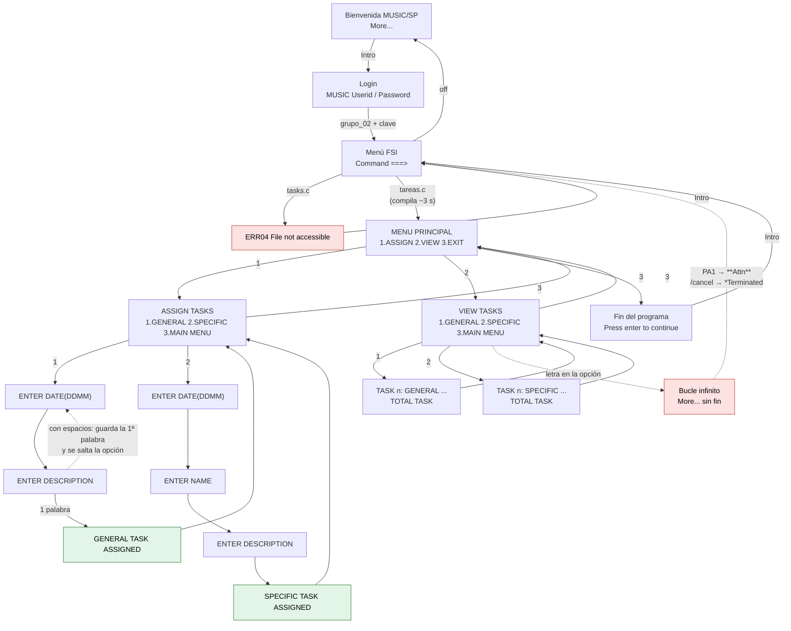

# Mapa de pantallas de la aplicación legada

Recorrido a mano de la aplicación legada el 2026-09-28 con wc3270 v4.5ga6, modelo 4 (43x80), cuenta `grupo_02`.
Cada captura de `img/a2/` lleva al lado un `.txt` con el texto exacto de la pantalla (80 columnas, 43 filas).
Todo lo que aparece aquí se ha comprobado en el mainframe; lo no probado está en "Pendiente".

## 1. Arranque

| Paso | Qué se hace | Qué responde | Captura |
|---|---|---|---|
| 1 | En `Command ===>` del menú FSI: `tasks.c` + Intro (nombre que da el guion) | `TASKS.C  ERR04 File not accessible` y `*Press enter to continue ... More...` | `00-tasks-c-no-existe` |
| 2 | En `Command ===>`: `tareas.c` + Intro | Compila con Waterloo C 3.2 (`154 lines, no errors`, `EXECUTION BEGINS`) y muestra el menú principal; tarda unos 3 s | `01-tareas-arranque` |

**El programa se llama `tareas.c`, no `tasks.c`** como dice el guion (errata).

## 2. Cómo funciona la pantalla

- `tareas.c` es un programa **de línea**, no de pantalla completa: escribe hacia abajo desde la fila 1 y **lee la respuesta en la fila 42**, bajo la línea de separación de la fila 41. No hay campos colocados por la pantalla.
- Cada pregunta termina en una línea con `?`. Lo que se escribe queda después como una línea más.
- El **estado** está en la fila 43, a la derecha:
  - `Reading`: el programa espera un dato.
  - `More...`: la pantalla está llena (se llegó a la fila 40); hay que pulsar Intro. Entonces la pantalla se limpia y sigue desde la fila 1, **sin las líneas anteriores** (`07-assign-general-fecha`, `08-more-siguiente-pagina`). Ese Intro no llega al programa como respuesta.
  - `**Attn**`: tras pulsar PA1 (apartado 6).
- Un Intro sin texto cuando el programa espera una opción no hace nada: sale otro `?` y sigue esperando.

## 3. Menús

```
MENU PRINCIPAL
1.ASSIGN TASKS  2.VIEW TASKS  3.EXIT
OPTION:
?
```

```
ASSIGN TASKS                                   VIEW TASKS
1. GENERAL TASK  2.SPECIFIC TASK  3. MAIN MENU  1. GENERAL TASK  2.SPECIFIC TASK  3. MAIN MENU
OPTION:                                        OPTION:
?                                              ?
```

La figura del guion muestra `MAIN MENU` y `0 - EXIT`, con una opción por línea. En la aplicación real el menú se llama `MENU PRINCIPAL`, las opciones van en una sola línea y **salir es la opción `3`**.

## 4. Transiciones

Diagrama: las flechas continuas son el funcionamiento normal; las discontinuas, los fallos de `tareas.c` (apartado 6) y cómo se sale de ellos.



Las mismas transiciones, en texto:

```
FSI --tareas.c--> MENU PRINCIPAL
MENU PRINCIPAL --1--> ASSIGN TASKS
MENU PRINCIPAL --2--> VIEW TASKS
MENU PRINCIPAL --3--> fin del programa: "*Press enter to continue ... More..." --Intro--> FSI
ASSIGN TASKS --1--> ENTER DATE(DDMM): ? --> ENTER DESCRIPTION: ? --> GENERAL TASK ASSIGNED --> ASSIGN TASKS
ASSIGN TASKS --2--> ENTER DATE(DDMM): ? --> ENTER NAME: ? --> ENTER DESCRIPTION: ? --> SPECIFIC TASK ASSIGNED --> ASSIGN TASKS
ASSIGN TASKS --3--> MENU PRINCIPAL
VIEW TASKS --1--> lista de tareas generales + TOTAL TASK --> VIEW TASKS
VIEW TASKS --2--> lista de tareas específicas + TOTAL TASK --> VIEW TASKS
VIEW TASKS --3--> MENU PRINCIPAL
```

Capturas: `02-view-tasks`, `05-assign-tasks`, `06-assign-general`, `09-assign-general-descripcion`, `13-assign-specific`, `14-specific-assigned`, `19-exit`.

## 5. Datos de una tarea y formato del listado

| Tipo | Datos que pide, en orden |
|---|---|
| General | fecha `DDMM`, descripción |
| Específica | fecha `DDMM`, nombre, descripción |

Formato de cada línea del listado (`12-listado-general`, `15-listado-specific`):

```
TASK 0: GENERAL 2809 ----- Prueba
TASK 3: SPECIFIC 0110 Imad Especifica1
TOTAL TASK
```

- `TASK <n>: <GENERAL|SPECIFIC> <fecha> <nombre> <descripción>`; en las generales el nombre aparece como `-----`.
- La numeración es común a los dos tipos (la primera específica fue la `TASK 3`, tras tres generales); cada listado muestra solo su tipo.
- El listado termina en `TOTAL TASK`, sin número. **Listado vacío:** solo `TOTAL TASK` (`03-view-general`, `04-view-specific`).
- Tras el listado vuelve solo al menú `VIEW TASKS`, sin pedir Intro (salvo `More...` si se llena la pantalla).

## 6. Comportamientos anómalos de `tareas.c`

| Entrada | Qué pasa | Captura |
|---|---|---|
| Descripción con espacios (`Prueba grupo 02`) | Se guarda **solo la primera palabra** (`Prueba`) y el programa **se salta la siguiente opción**: tras `GENERAL TASK ASSIGNED` sale `OPTION: ENTER DATE(DDMM):` y empieza otra tarea general sin que se haya pedido. Se repite en cada alta hasta que la descripción es de una sola palabra | `09-assign-general-descripcion`, `10-segunda-tarea`, `11-tarea-una-palabra`, `12-listado-general` |
| Opción numérica fuera de rango (`9`) | Vuelve a mostrar el menú. Correcto | `16-opcion-letra-bucle.txt` (inicio) |
| Opción con letra (`x`) | **Bucle infinito**: repite el menú sin esperar; MUSIC lo va parando en cada `More...` | `16-opcion-letra-bucle` |
| Fecha imposible (`3213`) o de 5 cifras (`12345`) | Se acepta sin validar y se guarda tal cual: el listado mostró `TASK 0: GENERAL 3213 ----- FechaMala1` y `TASK 1: GENERAL 12345 ----- FechaMala2` | sin captura (leído con `x3270if` en la misma sesión) |

Causa probable de los dos primeros casos: lectura con `scanf` (`%s` corta en el primer espacio y deja el resto en la entrada; `%d` no consume una letra). No se ha comprobado leyendo el código.

**Salir de un programa colgado:** PA1 (el estado pasa a `**Attn**`) → escribir `/cancel` + Intro (`*Terminated`) → Intro → menú FSI (`17-tras-pa1`, `18-tras-cancel`).

## 7. Persistencia de las tareas

- Mientras `tareas.c` sigue abierto, las altas aparecen en el listado.
- **Ninguna tarea sobrevivió a un reinicio de `tareas.c`**, ni saliendo con PA1 + `/cancel` ni saliendo con `3.EXIT`: al volver a arrancar, los dos listados salían vacíos y la numeración empezaba otra vez en `TASK 0` (`20-listado-tras-exit`).
- El guion dice "(los datos se almacenan en disco)". No se ha podido averiguar la causa sin mirar el fichero de datos, lo que prohíbe R13. **Pendiente de preguntar** (ver `docs/requisitos.md`).

## 8. Salida

`3` en el menú principal → `*Press enter to continue ... More...` → Intro → menú FSI → `off` → bienvenida de MUSIC → desconectar el emulador.

## 9. Mainframe bloqueado (pantalla de Hercules)

El 2026-09-28, al conectar para seguir con las pruebas, la primera pantalla no fue la bienvenida de MUSIC sino la consola del emulador Hercules (`21-hercules-bloqueado`):

```
 Hercules Version  : 3.07
 Host name         : EOLO
 ...
            HHH          HHH   The S/370, ESA/390 and z/Architecture
 ...                             My PC thinks it's a MAINFRAME
```

- Es el bloqueo que describe el guion cuando alguien desconecta antes de 1 s: el mainframe deja de aceptar sesiones hasta que el profesor lo resetea.
- Lo que se escribe en esta pantalla no llega a MUSIC: `tareas.c` dio `Keyboard locked` / `Operator error`.
- La sesión anterior del grupo había terminado de forma ordenada (`3.EXIT`, `off`, espera y cierre tras varios minutos conectados).
- **Para la GUI:** si la primera pantalla contiene `Hercules`, avisar al usuario de que el mainframe está bloqueado, desconectar respetando el segundo mínimo y no reintentar.

## Pendiente de probar

- Fecha con letras (`ab12`) y fecha vacía.
- Descripción y nombre muy largos (longitud máxima), con tildes o ñ, y vacíos.
- Listado largo (más de una pantalla de tareas) y cómo cae el `More...` en medio de la lista.
- Nombre con espacios en una tarea específica (probablemente el mismo fallo que la descripción).
