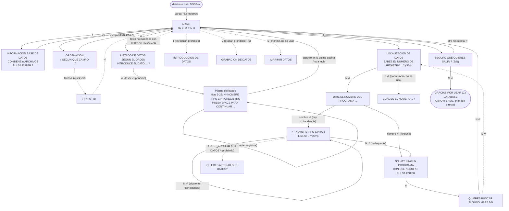

# Mapa de pantallas de la aplicación legada

Aplicación `Database/DATABASE.BAS` (GW-BASIC) en el DOSBox 0.74 incluido, lanzada con `database.bat`. Este mapa sale del código del programa (líneas citadas como `L<nº>`) y de un recorrido real el 2026-10-19: 20 capturas del área de cliente de DOSBox, guardadas en `C:\Users\imadx\sl-p3-pruebas\capturas-1\`.

## Gráfico de navegación

Las flechas indican la tecla que se pulsa (`⏎` = Enter). Las que usa el wrapper van en trazo continuo; las prohibidas o que no se usan, en discontinuo.

Recorridos del wrapper para cada funcionalidad:

| Funcionalidad | Secuencia desde el MENÚ |
|---|---|
| F1 — número de registros | `4` → leer fila 5 → `⏎` → MENÚ |
| F2 — datos por nombre | `7` → `N ⏎` → `nombre ⏎` → repetir {leer fila 5 → `N ⏎`} hasta "NO HAY NINGUN" → `⏎` → `N ⏎` → MENÚ |
| F3 — programas de una cinta | `3` → `4 ⏎` → MENÚ → `6` → `⏎` → repetir {leer filas 5-22 → espacio} 43 páginas → MENÚ |

## Geometría de la pantalla

- Modo texto 80x25 (`SCREEN 0`, `L10`). El área de cliente de DOSBox mide **640x400 píxeles** sin escalar, así que cada carácter ocupa **8x16 píxeles**: fila *f* (1-25) → `y = (f-1)*16`, columna *c* (1-80) → `x = (c-1)*8`.
- Solo hay dos colores: fondo `(0,0,0)` y texto gris `(170,170,170)`.
- **Esquinas redondeadas de Windows 11:** las esquinas inferiores del área de cliente salen con unos 40 píxeles de colores intermedios (filas de píxeles 391-399, columnas 0-7 y 632-639). Pisan las celdas (25,1) y (25,80), y la fila 25 empieza en la columna 1 en "PULSA SPACE…". Hay que evitarlo en la captura (ver "Pendiente").
- Teclado: DOSBox carga la distribución española. `SendKeys` envía bien `'`, `-` y `?` (`BC'S Q-?` aparece tal cual), e Imad probó la `Ñ` a mano.

## Arranque

- Al lanzarlo, el título de la ventana pasa a `… Program:  GWBASIC` antes de que salga el menú. Cargar los 763 registros tarda más de 1,5 s a 3000 cycles: la primera captura, a 1,5 s, salió negra. **Hay que esperar a ver el menú, no un tiempo fijo.**

## Menú principal (`L100-L180`)

| Fila | Col. | Texto |
|---|---|---|
| 4 | 32 | `M E N U` |
| 7, 9, 11, 13, 15, 17, 19 | 25 | `1 - INTRODUCIR DATOS` … `7 - BUSCAR DATOS` |
| 22 | 25 | `8 - ACABAR` |

- La lectura es con `INKEY$` (`L160`): una tecla `1`-`8`, sin Enter. Las demás teclas se ignoran.
- **Marca de "estoy en el menú":** `M E N U` en la fila 4, columna 32.
- Teclas prohibidas para el wrapper: `1` (introducir) y `2` (grabar), por R5.

## Opción 4 — Información base de datos (`L4000-L4200`) → F1

| Fila | Col. | Texto |
|---|---|---|
| 2 | 27 | `INFORMACION BASE DE DATOS` |
| 5 | 1 | `CONTIENE  763  ARCHIVOS` (dato: `NUM`, con los espacios de `PRINT` numérico) |
| 7 | 1 | `LA BASE DE DATOS ESTA ORDENADA SEGUN EL CAMPO 'ANTIGUEDAD'.` (o `DESORDENADA.` + el último campo) |
| 10 | 1 | `MEMORIA DISPONIBLE = 22526 BYTES` (baja con el uso: 17151 más tarde) |
| 24 | 1 | `PULSA ENTER           ?` (`INPUT`) |

- Para volver al menú, Enter.

## Opción 3 — Ordenación (`L3000-L3300`) → paso previo de F3

| Fila | Col. | Texto |
|---|---|---|
| 3 | 35 | `ORDENACION` |
| 10, 12, 14, 16 | 32 | `1 - NOMBRE`, `2 - TIPO`, `3 - CINTA`, `4 - ANTIGUEDAD` |
| 21 | 15 | `¿ SEGUN QUE CAMPO QUIERES ORDENAR LOS DATOS ? ` (`INPUT`) |

- Con `4` + Enter se rehace el orden de registro (`L3300`, bucle de 763 vueltas) y vuelve al menú **sin pedir nada más**. Tarda más de 1,2 s: a 1,2 s seguía en esta pantalla.
- Con `1`-`3` + Enter (quicksort, `L3120-L3280`) acaba con un `INPUT B` (`L3280`) y hay que pulsar Enter. No lo usa el diseño de F3.

## Opción 6 — Listar datos según orden (`L6000-L6060`) → F3

Pregunta inicial:

| Fila | Col. | Texto |
|---|---|---|
| 1 | 27 | `LISTADO DE DATOS SEGUN EL ORDEN` |
| 5 | 1 | `ORDENACION SEGUN EL CAMPO=ANTIGUEDAD` |
| 7-8 | 1 | `INTRODUCE EL DATO DEL PRIMER PROGRAMA A VISUALIZAR` / `O ENTER PARA VER DESDE EL PRINCIPIO` |
| 10 | 30 | `?` (`INPUT N$`) |

- Si se pulsa Enter, empieza en el registro 1.
- **Con orden ANTIGUEDAD, un texto no numérico vuelve directamente al menú** (`L6006`: `"DEFENDER" > "763"` como cadena → `RETURN`). Se confirmó en la captura 07, que muestra el menú. Para F3 se usa Enter.

Página del listado (18 filas por página):

| Fila | Col. | Texto |
|---|---|---|
| 3 | 7 | Cabecera `Nº    NOMBRE    TIPO    CINTA    REGISTRO` |
| 5-22 | — | Una fila por programa: **Nº** termina en la col. 8 (`LOCATE Y,9-LEN(N$)`, con signo); **NOMBRE** en col. 13 (hasta 30 car.); **TIPO** en col. 46 (hasta 15); **CINTA** en col. 66 (hasta 5); **REGISTRO** termina en la col. 77 (`L6020`) |
| 25 | 1 | `PULSA SPACE PARA CONTINUAR U OTRA TECLA PARA ACABAR` |

- Espacio pasa a la página siguiente. Cualquier otra tecla vuelve al menú. En la última página, cualquier tecla vuelve al menú (`L6050`).
- 763 registros / 18 por página = **43 páginas** (la última con 7 filas).
- La página 2 empieza en el Nº 19 (captura 06). La cinta `B-E` del registro 20 sale tal cual en la col. 66.
- `CLS` en cada página (`L6011`): no quedan restos de la anterior.

## Opción 7 — Buscar datos (`L7000-L7090`) → F2

| Paso | Fila, col. | Texto | Respuesta del wrapper |
|---|---|---|---|
| Título | 1, 30 | `LOCALIZACION DE DATOS` | — |
| a | 5, 1 | `SABES EL NUMERO DE REGISTRO QUE QUIERES BUSCAR? (S/N) ` | `N` + Enter (solo acepta `S` o `N` en mayúscula, `L7010`) |
| b | 10, 1 | `DIME EL NOMBRE DEL PROGRAMA QUE QUIERES VER     ` | nombre + Enter (`INSTR`, subcadena, distingue mayúsculas) |
| c (hay coincidencia) | 5, 6 | ` 50  -  DEFENDER   ARCADE   CINTA:C` (formato `N;" - ";N$;"   ";T$;"   CINTA:";C$`, `L7060`) | — |
| c | 7, 1 | `ES ESTE ? (S/N)  ` | `N` + Enter → busca la siguiente coincidencia desde N+1 (`L7062`) |
| d (no hay más) | 12, 1 | `NO HAY NINGUN PROGRAMA CON ESE NOMBRE; PULSA ENTER` y `?` en 13, 1 | Enter |
| e | 10, 10 | `QUIERES BUSCAR ALGUNO MAS? S/N  ` | `N` + Enter → menú |

- DEFENDER dio los registros **50** (cinta C) y **323** (cinta V), en las capturas 10 y 11. Al responder `N` al segundo, sale el mensaje del paso d (captura 12).
- Sin ninguna coincidencia (`BC'S Q-?`), se va directo al paso d (captura 15).
- **Nunca se responde `S`** a "ES ESTE?", porque llevaría a `QUIERES ALTERAR SUS DATOS?` (`L7065`), que permite modificar datos.
- Al leer el resultado, NOMBRE, TIPO y CINTA van separados por 3 espacios. Un nombre con 3 espacios seguidos sería ambiguo: no hay ninguno en los datos, pero lo comprobará el analizador.

## Opción 8 — Acabar (`L8000-L8040`)

- `SEGURO QUE QUIERES SALIR ? (LOS DATOS NO GRABADOS SE PERDERAN) (S/N) ` (fila 1) y `?` en la fila 2.
- `S` + Enter → `GRACIAS POR USAR (C) DATABASE` / `MENA SOFTWARE LTD.` / `Ok` (GW-BASIC queda en modo directo). Cualquier otra respuesta vuelve al menú.
- `SYSTEM` + Enter cierra GW-BASIC, pero DOSBox **sigue abierto** (`-noconsole` no lo cierra): el wrapper cierra el proceso de DOSBox.

## Comprobación de que `Database/` no cambia (R5)

SHA-256 de los 6 ficheros, iguales en el `.rar`, tras el uso manual de Imad y tras el recorrido automático (2026-10-19):

| Fichero | SHA-256 |
|---|---|
| `DATABASE.BAS` | `393209f8a3dfe5dbdabe6b9126bde31d10d284ef39483f44a30d432cdd39f661` |
| `DATOS.DAT` | `ca37fc1ccbbc62eccdd545bbdb7846e0c43d511300613d2b7e157f809fc52c11` |
| `gwbasic.bat` | `de0ec019014604c7d48e7eab6e384b24476cd1b946356693a481cdb6300ab6d8` |
| `GWBASIC.EXE` | `7c83bec46ef04c3766c41959dd00b92ee7b206557a97bd67d53d11bd3fbe0b79` |
| `GWBASIC.PIF` | `d27381323bab22e19d5642c8577babcf310427052b7da598c4972df31b98e9a6` |
| `INFORM.DAT` | `67cc1f9bb83f0564e2a74bb464c2e31255825482926fa8fb6ec0a7b1a575e50c` |

## Configuración propia de DOSBox y tiempos (segundo lanzamiento, 2026-10-19)

DOSBox se lanzó con `DOSBox.exe Database\gwbasic.bat -noconsole -conf p3-dosbox.conf`. El `.conf` está fuera de `Database/` y lleva `output=surface`, `windowresolution=original`, `scaler=none`, `aspect=false`, `cycles=max` y `keyboardlayout=auto`. Las esquinas redondeadas se quitaron con `DwmSetWindowAttribute(hwnd, 33 /*DWMWA_WINDOW_CORNER_PREFERENCE*/, 1 /*DONOTROUND*/)`, que devolvió `hr=0`.

- Las 5 capturas tienen **exactamente dos colores**, `(0,0,0)` y `(170,170,170)`, también en las esquinas: el problema de Windows 11 queda resuelto.
- Tiempos medidos esperando la marca de cada pantalla (capturas en `C:\Users\imadx\sl-p3-pruebas\capturas-2\`):

| Paso | Tiempo |
|---|---|
| Lanzamiento → título `GWBASIC` | 1886 ms |
| Lanzamiento → `M E N U` visible | 2344 ms |
| Opción 4 → pantalla de información | 24 ms |
| Opción 3 → `4` + Enter → menú (ordenar por ANTIGUEDAD) | 83 ms |
| Opción 6 → Enter → página 1 | 16 ms |
| **Listado completo, 43 páginas** | **3047 ms** |
| Tecla en la última página → menú | 17 ms |

- La página 43 contiene los registros 757-763 (7 filas), como se esperaba. F3 cabe holgadamente en una petición web.
- Hashes de `Database/` iguales después de este lanzamiento.
